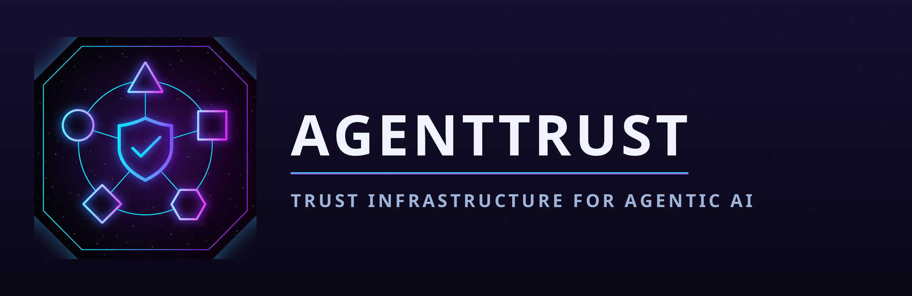
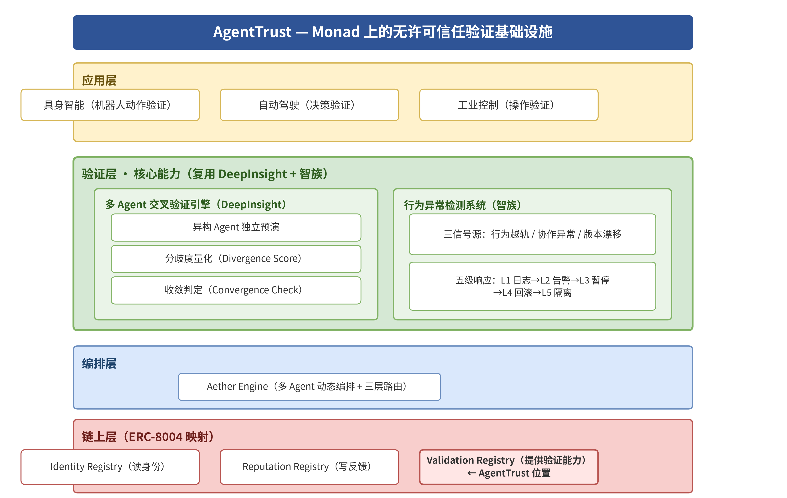

<p align="center">
  
</p>

<p align="center">
  <strong>Pre-execution verification for AI agents.</strong><br />
  A task is rehearsed independently by 3–5 heterogeneous validator agents before the main agent
  is allowed to act; their disagreement is quantified into a single number, and that number
  decides whether the task is cleared, re-rehearsed, or stopped.
</p>

<p align="center">
  
  
  
  
  
</p>

<p align="center">
  <a href="https://agenttrust-panel.vercel.app"><strong>▶ Live verification panel</strong></a>
  &nbsp;·&nbsp;
  <a href="https://testnet.monadscan.com/address/0x4479D63b5780e5DBa95feEB057Ed57B8E20b7053">Registry on MonadScan</a>
  &nbsp;·&nbsp;
  <a href="DEPLOYMENT.md">Deployment record</a>
</p>

> **The panel is live and reads chain 10143 directly.** Open
> <https://agenttrust-panel.vercel.app> — it enumerates the registry's own
> `CohortValidationOpened` events and renders every recorded decision. If you are on a network
> where `*.vercel.app` is unreachable, run `cd frontend && python -m http.server 8080` and open
> <http://localhost:8080> instead; it is the same static site.

---

## The problem

An autonomous agent that is about to touch a real system — a robot arm, a wallet, a production
database — is currently verified by nobody. It reports what it *plans* to do, and then it does
it. If its plan is wrong, illegal or out of scope, the first thing that notices is the damage.

AgentTrust puts a verification step in front of execution. Before the main agent runs, a cohort
of independent validator agents rehearses the same task from scratch. If they converge on the
same plan, the task is cleared. If they diverge, the divergence is measured, and past a
threshold the task is sent back for another round — or escalated to a human.

The verification result is not a private backend opinion: it is written to an
**ERC-8004 Trustless Agents Validation Registry** on Monad Testnet, so a third party can read
the decision, the divergence readings and the verdict hashes straight off the chain.

---

## Mechanism



*AgentTrust — 无许可信任验证基础设施. The four layers, read top-down, and where each one lives in
this repository:*

| Layer | What it holds | In this repo |
| --- | --- | --- |
| **应用层** | Embodied AI (robot action verification), autonomous driving (decision verification), industrial control (operation verification) | The three sample tasks: `warehouse-pick-001`, `arm-reach-boundary-002`, `unauthorized-override-003` |
| **验证层 · 核心能力** | **Multi-agent cross-verification engine** — heterogeneous agents rehearse independently, divergence is quantified, convergence is judged. **Behaviour-anomaly detection** — three signal sources (trajectory deviation / cooperation anomaly / version drift) with a five-level response (L1 log → L2 alert → L3 pause → L4 rollback → L5 isolate) | `divergence/` (Divergence Score + Convergence Check), `orchestrator/` (fan-out, verdicts, K-round machine), `validators/` (the heterogeneous cohort) |
| **编排层** | Aether Engine — dynamic multi-agent orchestration and three-tier routing | `scripts/demo/run_demo.py` (one-command orchestration), `orchestrator/config.py` (routing and thresholds) |
| **链上层 (ERC-8004 映射)** | Identity Registry (read identity) · Reputation Registry (write feedback) · **Validation Registry (provides verification) ← AgentTrust 位置** | `contracts/contracts/AgentTrustValidationRegistry.sol` — the Validation Registry slot, deployed at `0x4479D6…7053` |

The diagram's verification layer shows two engines; this repository implements the
**multi-agent cross-verification engine** end to end (divergence quantification, convergence
judgement, on-chain attestation). The behaviour-anomaly system's three signal sources and
five-level response are the surrounding product context, not a claim that they are implemented
here.

Every constant in the mechanism — the `0.4 / 0.3 / 0.3` weights, `θ_low = 1.5`, `θ_high = 3.0`,
`K = 3` — is read from the shipped code in `divergence/core.py` and `orchestrator/config.py`, and
is asserted against the chain by `contracts/test/` and `scripts/verify_deployment.py`.

### Divergence metrics — work order §2.3

The cohort's rehearsals are compared on three axes, each normalised so they are on the same
scale:

| Metric | Question it answers | Method |
| --- | --- | --- |
| `D_disc` | Did they plan the same *steps*? | Normalised Levenshtein edit distance over the action sequences |
| `D_traj` | Did they move the same *way*? | Dynamic time warping (DTW) over the trajectory series, normalised by path length |
| `D_end` | Did they end up in the same *place*? | L2 / Mahalanobis distance over the terminal state vectors |

Agreement between validators is measured separately with **Kendall's W** (coefficient of
concordance), `W = 12S / (m²(n³ − n))` with a mid-rank tie correction, tested with
`χ² = m(n − 1)W` at `df = n − 1`.

```
D_total = 0.4 · D_disc + 0.3 · D_traj + 0.3 · D_end        # weights w = (0.4, 0.3, 0.3)
D_rel   = D_total / D_base                                  # D_base = task baseline difficulty
```

### Decision bands — work order §2.4

```
D_rel ≤ 1.5                 → Approved            the main agent may execute
1.5 < D_rel ≤ 3.0           → Rehearse            another round, up to K = 3 rounds
D_rel > 3.0                 → Rejected / Escalate
```

`θ_low = 1.5` and `θ_high = 3.0` are the frozen work-order values. Above `θ_high` the verdict
splits on Kendall's W: **statistically significant** disagreement means the cohort agrees that
the plan is bad — that escalates to a human; **non-significant** disagreement means the cohort
is simply not coherent, and the task is rejected. The re-calibration slot (ROC + Youden's J) is
`divergence/calibrate.py`; it is non-blocking and returns the frozen defaults when no
calibration set is present.

### Fail-closed behaviour — work order §2.6

| Condition | Result |
| --- | --- |
| Fewer than `min_usable = 2` validators returned a usable verdict | `INSUFFICIENT_VALIDATORS` — no decision |
| `D_base ≤ 0` or missing | `INSUFFICIENT_BASELINE` — no decision |
| `K = 3` rounds without convergence | `Escalated` — routed to a human |
| A validator's API key is missing | that member reports itself unavailable; the cohort continues if ≥ 2 remain |

Nothing in the pipeline guesses when it lacks information. A missing key, a dead endpoint or an
empty cohort stops the round rather than producing a verdict nobody can audit.

### Anti-fake heterogeneity — work order §2.5

A cohort of the same model wearing three different prompts is not three opinions. Three
constraints are enforced in `validators/cohort.py::verify_heterogeneity()` before a cohort may
run:

1. **different underlying model source** (`model_family`)
2. **different vendor / inference endpoint** (resolved endpoint URL)
3. **different prompting framework and stack** (`framework`)

Cohort members never share context. Each receives the `TaskRequest` and nothing else; verdicts
are exchanged only through the orchestrator.

---

## Quickstart

Requires **Python 3.10+** and **Node 18+** (Node only for the contracts). No Docker, no Redis,
no database.

### 1. Install the Python side and run the tests

```bash
pip install -r requirements.txt        # numpy + PyYAML + pytest
pytest tests/ -q                       # 231 tests
node tests/panel_render_harness.mjs    # 12 checks - runs frontend/app.js against a DOM stub
```

### 2. Run the end-to-end demo (no API key, no network)

```bash
python scripts/demo/run_demo.py --cohort offline --chain dry-run
```

One command runs the whole loop — submit → fan out → quantify → decide → record — over three
sample tasks, and prints a real `D_total` / `D_rel` / verdict for each. `--chain dry-run`
appends to a local ledger and labels every receipt `mode: "dry-run"`, so an offline run can
never be mistaken for an on-chain one.

Sample output (`artifacts/latest-record.json`):

| task | rounds | `D_total` | `D_rel` | decision |
| --- | --- | --- | --- | --- |
| `warehouse-pick-001` | 1 | 0.1445 | 0.2890 | **Approved** |
| `arm-reach-boundary-002` | 3 | 0.9046 | 1.8092 | **Escalated** (K rounds exhausted) |
| `unauthorized-override-003` | 1 | 1.3911 | 3.9746 | **Escalated** (`D_rel > θ_high`, significant W) |

### 3. Open the verification panel

**Deployed:** <https://agenttrust-panel.vercel.app>

```bash
# or run it locally - same static site, no build step
cd frontend && python -m http.server 8080
# then open http://localhost:8080
```

Two data sources, and the banner says which one is in use:

* **LIVE** — when `frontend/data/deployment.json` exists, the panel reads the registry's own
  `CohortValidationOpened` events from the deploy block onwards and renders every record. There
  is no local index the page depends on: a verifier holding nothing but the deployment receipt
  sees the full history.
* **SIMULATED** — otherwise it renders the dry-run feed (`frontend/data/records.json`) and says
  `SIMULATED` on screen, out loud.

Either way, the panel also exposes an optional **Connect wallet**
button (EIP-1193) that requests accounts and switches the wallet to chain 10143, so an operator
can confirm which chain they are looking at from their own account. It is **read-only, by
design**: the panel is a verifier, so it never asks a wallet to sign, and it degrades to the
public-RPC read path when no wallet extension is installed. The whole directory is a static
site — drop it on Vercel or GitHub Pages as-is.

### 4. Use real models instead of the offline fixtures

```bash
cp .env.example .env       # fill DASHSCOPE_API_KEY and MOONSHOT_API_KEY
python scripts/demo/run_demo.py --cohort live
```

Live mode runs Qwen (DashScope) and Kimi (Moonshot) through the adapters in `validators/`.
`--cohort auto` uses live members whose credential is present and falls back to the
deterministic offline cohort when fewer than two can run.

### 5. Write the records to Monad Testnet

```bash
python scripts/demo/run_demo.py --task all --cohort offline --chain live --nonce 4
```

`--chain live` sends real transactions: `openCohortValidation`, then one
`attestCohortVerdict` per cohort member (the orchestrator relays each member's EIP-191
signature, so **the validators need no MON**), then `finalizeValidation`. A full 3-task pass is
15 calls and costs **~1.31 MON** — Monad bills the full gas *limit*, so the writer estimates gas
and adds 20% headroom rather than using a blanket limit (see `DEPLOYMENT.md` §2b).

`--nonce` is required on a re-run: `validationId` is the ERC-8004 `requestHash`, deterministic by
design, and the registry rejects a repeat with `RequestAlreadyExists`.

---

## Contracts

Solidity `0.8.24`, Hardhat, `viaIR` enabled, `evmVersion: paris`.

```bash
cd contracts
npm install
npm run compile        # hardhat compile
npm test               # 37 tests (incl. the cross-language attestation-encoding vector)
npm run deploy:testnet # deploy to Monad Testnet 10143 and emit a receipt
npm run verify:deployed
```

`AgentTrustValidationRegistry` implements the ERC-8004 Validation Registry surface
(`validationRequest` / `validationResponse` / `getValidationStatus` / `getSummary` /
`getAgentValidations` / `getValidatorRequests`) and adds the cohort workflow on top of it:
`submitCohortVerdict` (members sign their own verdict), `attestCohortVerdict` (the orchestrator
relays a verdict with the member's EIP-191 signature) and `finalize` (re-derives the tri-level
decision on chain from the frozen constants in `DivergenceLib`).

Two guards refuse to run against the wrong network: `contracts/scripts/deploy.js` and
`contracts/scripts/verify-deployed.js` both abort when the connected chain reports **143**
(mainnet), and `orchestrator/config.py::validate_for_live_chain()` refuses to build a live
client for it. Testnet is **10143**.

---

## Testnet evidence

| What | Where |
| --- | --- |
| Deployment record — Chain ID, registry address, deploy tx, explorer links, timestamp | **[DEPLOYMENT.md §4](DEPLOYMENT.md#4-deployment-record)** |
| Live cohort records written to the registry | [DEPLOYMENT.md §2](DEPLOYMENT.md#2-deployment-status) |
| Monad gas model (why the writer estimates instead of hardcoding) | [DEPLOYMENT.md §2b](DEPLOYMENT.md#2b-monad-gas-model-why-the-writer-estimates-instead-of-hardcoding) |
| Network parameters (RPC, explorer, faucet, compiler settings) | [DEPLOYMENT.md §1](DEPLOYMENT.md#1-network) |
| Three-command deploy procedure | [DEPLOYMENT.md §3](DEPLOYMENT.md#3-how-to-deploy-three-commands) |
| Credential-free verification | [DEPLOYMENT.md §5](DEPLOYMENT.md#5-verifying-the-deployment-without-any-credential) |

Network: **Monad Testnet, chainId 10143** — RPC `https://testnet-rpc.monad.xyz`, explorer
`https://testnet.monadscan.com`, faucet `https://faucet.monad.xyz`.

**Status, stated plainly: the registry is deployed and exercised.** `AgentTrustValidationRegistry`
lives at `0x4479D63b5780e5DBa95feEB057Ed57B8E20b7053` on Monad Testnet (chainId **10143**), deployed
in block `70771345`. No address, transaction hash or explorer link in this repository is a
placeholder dressed up as real data; the deployment record is filled in only from
`contracts/deployments/monad-testnet-10143.json`, which the deploy script writes and nothing else
does.

Two complete cohort lifecycles have been written through the live path and read back from the
chain — one **Approved** (`D_rel` 0.289) and one **Escalated** (`D_rel` 3.975); the Escalated
figure matches the offline deterministic cohort to three decimals:

| What | Value |
| --- | --- |
| Registry | `0x4479D63b5780e5DBa95feEB057Ed57B8E20b7053` |
| Bytecode | `13302` bytes |
| Frozen constants read back | `weights 400/300/300`, `theta 1500/3000`, `kRounds 3` |
| Finalised records | 2 (`0x7a21816a…` Escalated, `0xc8de0a96…` Approved) |

Verified against the live network with no credential:

```
eth_chainId                                       → 0x279f = 10143         ✅
eth_getCode(0x4479D63b5780e5DBa95feEB057Ed57B8E20b7053) → 13302 bytes       ✅
weightsMilli() / thresholdsMilli() / kRounds()    → 400,300,300 / 1500,3000 / 3   ✅
```

Reproduce with:

```bash
python scripts/verify_deployment.py \
    --address 0x4479D63b5780e5DBa95feEB057Ed57B8E20b7053 \
    --rpc https://testnet-rpc.monad.xyz
python .tmp/chain_state.py            # enumerate every record on the registry
```

> **Monad bills the full gas *limit*, not the gas used.** A hardcoded limit therefore costs the
> same whether a call needs 52 697 gas or 429 648. `orchestrator/chain.py` estimates gas and adds
> 20% headroom; measured cost for a full 3-task live demo is **~1.31 MON** versus **~4.59 MON**
> under a blanket 3 000 000 limit. See `DEPLOYMENT.md` §2b.

The verify script exits non-zero, with no output file, if the RPC reports a chain id other than
10143, if the address has no bytecode, or if the on-chain weights and thresholds differ from
`400 / 300 / 300` and `1500 / 3000` (spec §2.3 / §2.4).

---

## Repository layout

```
agenttrust/
├── README.md            # this file
├── DEPLOYMENT.md        # Chain ID 10143, address, deploy tx, explorer URLs, timestamps
├── LICENSE              # MIT
├── .env.example         # placeholders only - RPC_URL_10143 / DASHSCOPE_API_KEY / MOONSHOT_API_KEY
├── contracts/           # Solidity + Hardhat deploy/verify scripts, ERC-8004 interfaces
├── divergence/          # pure-Python library: edit distance, DTW, Mahalanobis, Kendall's W,
│                        #   D_total / D_rel, verdict model, calibrate.py
├── orchestrator/        # fan-out, verdict collection, tri-level thresholds, K-round state
│                        #   machine, chain writer, monitoring hook
├── validators/          # qwen_max.py / kimi.py / base.py / simulated.py + cohort.yaml
├── frontend/            # verification panel: reads 10143 registry events, renders records
├── scripts/demo/        # one-command end-to-end demo + sample tasks
├── tests/               # divergence unit tests + orchestrator / cohort / hashing tests
│                        #   + panel_render_harness.mjs (renders the panel headlessly)
└── docs/                # architecture.png, logo lockup + icon, demo + pitch scripts,
                         #   delivery summary
```

Every layer follows the same split: a thin entry point, a service that holds the rules, and a
repository/adapter that talks to the outside world. The divergence library has no dependency on
the orchestrator; the orchestrator has no dependency on the HTTP layer; the chain writer is
swapped for a dry-run ledger by one argument.

### Deliverables

| Work order | Deliverable | Where |
| --- | --- | --- |
| D1 | GitHub repository — README, LICENSE, `.env.example` | this file, [LICENSE](LICENSE), [.env.example](.env.example) |
| D2 | Contract layer — ERC-8004 Validation Registry + deploy scripts | `contracts/` |
| D3 | Divergence library + unit tests | `divergence/`, `tests/` |
| D4 | Orchestration — fan-out, verdict collection, thresholds, K-round machine | `orchestrator/` |
| D5 | Heterogeneous validator config + triad declaration | `validators/cohort.yaml` |
| D6 | Verification panel reading Monad Testnet | **[agenttrust-panel.vercel.app](https://agenttrust-panel.vercel.app)** (`frontend/`) |
| D7 | Testnet deployment evidence | [DEPLOYMENT.md](DEPLOYMENT.md) |
| D8 | End-to-end demo script | `scripts/demo/run_demo.py` |
| D9 | Demo + pitch video scripts | [docs/DEMO_SCRIPT.md](docs/DEMO_SCRIPT.md), [docs/PITCH_SCRIPT.md](docs/PITCH_SCRIPT.md) |
| — | Self-check: verification evidence, deviations, outstanding owner actions | [docs/DELIVERY_SUMMARY.md](docs/DELIVERY_SUMMARY.md) |

### Re-running the demo against a deployed registry

`validationId` is the ERC-8004 `requestHash`, deliberately deterministic so an unchanged request
maps to an unchanged id. The registry rejects a repeated hash with `RequestAlreadyExists`, so a
second live run of the same task needs a fresh nonce:

```bash
python scripts/demo/run_demo.py --task unauthorized-override-003 --cohort live --chain live --nonce 2
```

---

## Scope and honesty

This repository is deliberately explicit about what has and has not been exercised.

* **The offline cohort is not a model output.** `validators/simulated.py` is a seeded,
  deterministic fixture. Every verdict it produces is tagged
  `provider="offline-deterministic"`, and the demo prints a note saying so. It exists so the
  demo, the tests and the panel run with no credential — it is never presented as a rehearsal.
* **Transactions have been sent — two full cohort lifecycles are on chain** (see *Testnet
  evidence* above). The default chain mode is still `dry-run`, which appends to a local ledger and
  labels each receipt `mode: "dry-run"`, `simulated: true`, `txHash: null`; `--chain live` is what
  writes to 10143.
* **The live signing path is verified live *and* by tests.** `RegistryClient.submit()` wrote two
  finalised records to the deployed registry; the Solidity functions it calls are additionally
  covered by the Hardhat suite against an in-process chain, including the cross-language
  attestation-encoding vector.
* **One full 3-task live pass is still outstanding.** Two orphan requests from an earlier run that
  hit the blanket-gas bug remain on chain and unfinalised (`0xf0c53916…`, `0x1dbac3da…`); they do
  not block a fresh `--nonce` run. Completing a single clean 3-band pass needs ~1.31 MON and the
  deployer is currently at **0.031 MON** — top up at `https://faucet.monad.xyz` and run
  `python scripts/demo/run_demo.py --task all --cohort offline --chain live --nonce 4`.
* **The Rejected band is covered by unit tests**, not by the sample demo tasks — with the
  shipped offline cohort the validators disagree coherently, so the top band resolves to
  `Escalated`. `tests/test_core.py` covers `Rejected` directly.
* **The behaviour-anomaly half of the architecture diagram is product context, not a claim.**
  `docs/architecture.png` shows two verification engines (multi-agent cross-verification and a
  behaviour-anomaly detection system with a five-level response). This repository implements the
  **multi-agent cross-verification engine** — divergence quantification, convergence judgement,
  on-chain attestation. The three anomaly signal sources and the `L1 → L5` response ladder are
  drawn as the surrounding product picture; no code here implements them.
* **All brand and architecture assets are the supplied originals.** `docs/architecture.png`
  (3300×2090) and `docs/AgentTrust_logo_lockup_2000.png` (2000×650, the filename the work order
  names) are the provided files, copied in unmodified. `docs/AgentTrust_logo_icon.png` is the
  lossless 1024×1024 PNG; a JPEG of the same artwork was also supplied and is deliberately *not*
  used, since replacing a lossless asset with a lossy one is a downgrade.
* **"Connect wallet" means connect to the chain, not sign with it.** The work order's demo
  storyboard lists a wallet-connection shot. This panel is a read-only verifier, so its wallet
  button requests accounts and switches the network but never prompts for a signature — the
  request itself is signed server-side by the requester key (`DEPLOYER_PRIVATE_KEY`), which is
  how the orchestrator submits `openCohortValidation`. `docs/DEMO_SCRIPT.md` shot 2 records the
  chain-connection shot on those terms and states it on screen.

---

## Team

**StarryCrab Tech (星蟹科技)**

Built for **Monad Metropolis** — Track 4: Trust / Identity / AI Infrastructure.

Contact: open an issue on this repository.

---

## License

MIT — see [LICENSE](LICENSE).
